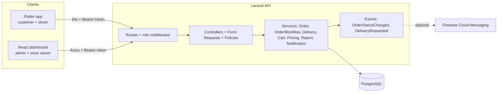

# RUPP Eat — Campus Food Ordering & Delivery

A full-stack food ordering and classroom-delivery platform for the **Royal University of Phnom Penh**.
Students, lecturers and staff order from campus stores in the **Flutter** app. Drivers deliver to
**faculty › building › floor › classroom** in the same app's driver mode. Store owners and administrators
use the **React** dashboard. Everything talks to one **Laravel** REST API backed by **PostgreSQL**.

```
rupp-eat/
├── mobile/      Flutter app (customer + driver interfaces) — open this folder in Android Studio
├── backend/     Laravel 12 REST API (Sanctum, policies, services, migrations, seeders)
├── dashboard/   React 19 + Vite + Tailwind 4 (admin dashboard + store dashboard)
└── database/    ERD.md (schema + state machine), API.md (endpoint reference)
```

## Architecture



- **Laravel**: thin controllers, business rules in `app/Services`, `JsonResource` output, Form Request validation,
  `role:` middleware + Policies (`OrderPolicy`, `StorePolicy`, `ProductPolicy`, `DeliveryPolicy`), DB transactions with row locks.
- **Flutter**: feature folders (`lib/features/<feature>/{data,models,providers,screens,widgets}`), Provider for state, Dio, secure token storage.
- **React**: separate `AdminLayout` and `StoreLayout`, reusable UI kit (`components/ui.jsx`), Recharts analytics.

## Requirements (already on this PC)

PHP 8.2 with `pdo_pgsql` (XAMPP) · Composer · PostgreSQL 18 · Node 24 · Flutter 3.50 (`D:\flutter`) · Android Studio + Pixel_8 emulator

**Everyday start-up** (three terminals, from the `RUPP EAT` folder):

```powershell
& ".\database\start-db.ps1"
```

```powershell
cd backend; php artisan serve --host=0.0.0.0 --port=8000
```

```powershell
cd dashboard; npm run dev
```

Then run the mobile app from Android Studio.

## 1. Backend (Laravel + PostgreSQL)

```powershell
cd backend
composer install            # first time only
copy .env.example .env      # first time only, then: php artisan key:generate
```

**Database.** The project has its own PostgreSQL 18 dev database in `database\pgdata`, separate from your main
PostgreSQL service. It listens on `127.0.0.1:55432` only and uses a generated password that is already saved in
`backend/.env`. Start it once after each reboot:

```powershell
& ".\database\start-db.ps1"
```

Then run the API (from `backend`):

```powershell
php artisan serve --host=0.0.0.0 --port=8000
```

Reset to fresh demo data at any time: `php artisan migrate:fresh --seed`. Stop the database with `& ".\database\stop-db.ps1"`.

To use your main PostgreSQL server instead, set `DB_PORT=5432` and your `postgres` password in `backend/.env`
(or run `& .\scripts\set-db-password.ps1` from `backend`), create the `rupp_eat` database, and run `php artisan migrate:fresh --seed`.

`--host=0.0.0.0` lets the Android emulator (`10.0.2.2`) and phones on your Wi-Fi reach the API.

## 2. Dashboard (React)

```powershell
cd dashboard
npm install
npm run dev                 # http://localhost:5173  (proxies /api to :8000)
```

## 3. Mobile app (Flutter) in Android Studio

1. Android Studio → **Settings → Plugins → Marketplace** → install **Flutter** (installs Dart too) → restart.
2. **File → Open** → `RUPP EAT\mobile`. If asked, set Flutter SDK path to `D:\flutter`.
3. Start the **Pixel_8** emulator (Device Manager), choose it in the device dropdown, press **Run ▶** (`main.dart`).

Command line alternative: `cd mobile; flutter run`.
On a real phone use your PC's LAN IP: `flutter run --dart-define=API_BASE_URL=http://192.168.x.x:8000/api`.

### Google Maps key (for the real Google map)

1. In [Google Cloud Console](https://console.cloud.google.com/), create an API key and enable **Maps SDK for Android**
   (billing must be enabled). Restrict the key to Android apps with package `kh.edu.rupp.rupp_eat`.
2. Add it to `mobile/android/local.properties` (this file is gitignored, so the key never reaches GitHub):

   ```
   MAPS_API_KEY=AIza...your key...
   ```
3. Rebuild the app (Run ▶). Without a key, the app shows the same maps as a drawn campus plan, so every map feature keeps working.

**Emulator GPS:** put the emulator on campus with Extended controls (⋯) → Location, or
`adb emu geo fix 104.8902 11.5689`. The driver app also needs Location turned on in the emulator's Android settings.

## Campus maps (RUPP Campus I only)

All maps are locked to the RUPP Campus I outline (camera bounds and zoom 16–20), not the whole city.

| Feature | Where |
|---|---|
| **Campus food map**: every store pinned on its real building, tap to order | Home → map icon / "Find food on the RUPP Campus I map" |
| **Pick building on map**: choose the delivery building by tapping it | Checkout → "Pick your building on the campus map" |
| **Live driver tracking**: store, your building and the driver's real GPS, refreshed every 5 s | Order screen while the order is active |
| **Driver navigation**: my position, store, destination, route line and "Google Maps" turn-by-turn button | Driver → active delivery |

Driver GPS is sent every ~8 s only while the driver is online (and cleared when they go offline). Only the customer
of that order (plus the store and admins) can see it, and only while the order is on its way.

**Map data.** Building positions and footprints come from OpenStreetMap (© OpenStreetMap contributors, ODbL).
Building names follow the official *Map of Royal University of Phnom Penh* (2022). The data is in
[`backend/database/data/rupp_campus_osm.json`](backend/database/data/rupp_campus_osm.json): 17 buildings
(A, B, C, D, T, STEM, Hun Sen Library, RUPP Library, CKCC, Student Canteen, Auditorium Hall, DMC, IFL main/B/C,
French Library, CJCC). Grouping buildings into faculties/areas and the floor/room numbers are sample data that admins
can edit under Campus locations.

## Roles and driver sign-up

The mobile **Sign up** screen asks *Order food* (student / lecturer / staff → customer) or *Deliver food* (driver).
Drivers enter vehicle, plate number and an ID number. They can log in straight away but stay **pending** (cannot go online)
until an admin verifies them in the dashboard under **Drivers → Awaiting verification**. Admins get a notification for each application.

## Demo accounts (password for all: `password123`)

| Role | Login | Where |
|---|---|---|
| Administrator | `admin@rupp.edu.kh` | Dashboard |
| Store owner | `owner.cafe@rupp.edu.kh` (Campus Café), `owner.khmer@…`, `owner.noodle@…`, `owner.sandwich@…`, `owner.fresh@…` | Dashboard |
| Driver (verified, online) | `driver1@rupp.edu.kh` · also `driver2@…` (verified) and `driver3@…` (awaiting verification) | Mobile app |
| Student | `student@rupp.edu.kh` or ID `E20230001` · also `vannak.student@…`, `bopha.student@…`, `rithy.student@…` | Mobile app |
| Lecturer / staff | `lecturer@rupp.edu.kh`, `staff@rupp.edu.kh` | Mobile app |

The seed includes 5 stores with 33 menu items pinned on real campus buildings, 17 real RUPP Campus I buildings
(~330 rooms), 30 days of order history for charts, and live orders so each role has something to do:
Campus Café has 2 new orders to accept, and driver1 has a delivery request waiting.

## Demo walkthrough (all four roles)

1. **Student** (app): browse → add to cart → Checkout → *Classroom delivery* → Engineering Building › Floor 3 › Room 305 → Place order.
2. **Store owner** (dashboard `/store/orders`): Accept → Start preparing → *Request driver* → Mark ready.
3. **Driver** (app, log out and log in as `driver1`): Requests → Accept → Confirm food pickup → I'm arriving → Confirm delivered.
4. **Student**: tracking screen updates every 10 s; notifications at each step; then Rate your order / Order again.
5. **Admin** (dashboard): live orders, reports + CSV export, verify `driver3`, approve the pending *Num Pang Corner* application, edit delivery fee.

Self-pickup: choose *Self-pickup* at checkout; the app shows a 4-digit pickup code that the store enters to confirm hand-over.

## Security & integrity

- Sanctum bearer tokens (Android Keystore-backed storage in the app); bcrypt password hashing; login/register rate-limited.
- Role middleware on every route group; Policies restrict stores to their own products/orders and drivers to assigned deliveries
  (customer phone is only visible to the assigned driver).
- Prices, fees and totals are always computed on the server from the database; the client never sends prices.
- Orders are created in one transaction with `SELECT … FOR UPDATE` on products (no overselling), plus DB `CHECK` constraints.
- Duplicate submissions are prevented with an `Idempotency-Key` header (unique per customer).
- Driver acceptance uses a row lock — only one driver can take a delivery.
- Cash is marked **paid only when the driver/store confirms hand-over**. **Bakong KHQR** is wired as a disabled option
  (`KHQR_ENABLED=false`) and is never shown as paid without real verification.

## Notifications & real time

Every status change writes an in-app notification (inbox + badge, polled every 20 s) and fires a broadcast event
(`BROADCAST_CONNECTION=log` by default; switch to Laravel Reverb/Pusher for websockets). Push notifications:
add `mobile/android/app/google-services.json` (run `flutterfire configure`) and set `FCM_PROJECT_ID` and
`FCM_CREDENTIALS_PATH` (service-account JSON) in `backend/.env`. Without these, the app falls back to polling.

## Development phases (done)

1. Planning: roles, schema ([database/ERD.md](database/ERD.md)), API ([database/API.md](database/API.md))
2. Backend: migrations, models, services, policies, 90+ endpoints, seeders
3. Flutter: customer app (home, stores, search, cart, checkout, tracking, history, reviews, favorites, support, profile) and driver app
4. React: admin dashboard (13 pages) and store dashboard (5 pages)
5. Integration: 130 automated end-to-end API checks across all four roles; app verified on the Android emulator
6. Documentation

## Deployment notes

- Backend: PHP-FPM + Nginx, `APP_ENV=production`, `APP_DEBUG=false`, `php artisan config:cache route:cache`, queue worker
  (`QUEUE_CONNECTION=database`), real mail driver for password-reset codes, HTTPS.
- Dashboard: `VITE_API_URL=https://api.example/api npm run build`, then serve `dist/`. Set `CORS_ALLOWED_ORIGINS`.
- Mobile: `flutter build apk --release --dart-define=API_BASE_URL=https://api.example/api` (configure a release signing key).
