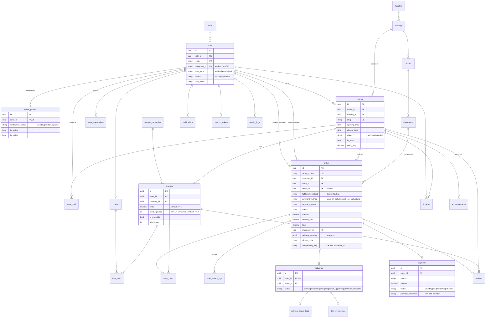
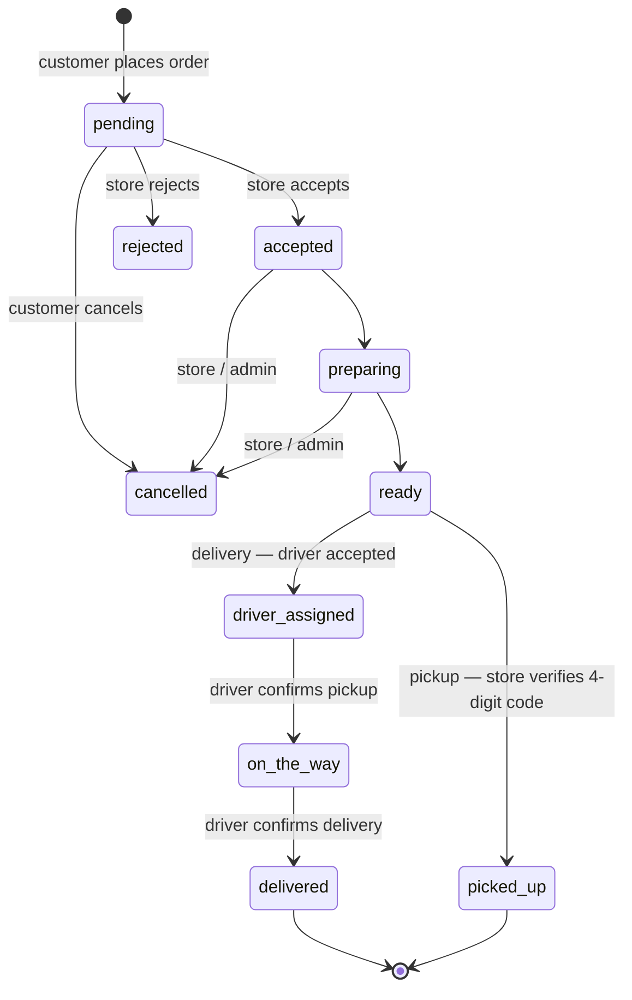

# RUPP Eat — Database design (PostgreSQL)

All primary keys are **UUIDs** (`HasUuids`). Money is `numeric(10,2)` in USD. Timestamps use the
`Asia/Phnom_Penh` timezone. Soft deletes on `users`, `stores`, `products`, `faculties`, `buildings`, `classrooms`
so order history never loses its references.

Migrations: [`backend/database/migrations`](../backend/database/migrations) · Seeders: [`backend/database/seeders`](../backend/database/seeders)

## Entity–relationship diagram

## Key constraints & indexes

| Table | Constraint / index | Why |
|---|---|---|
| `orders` | `UNIQUE(customer_id, idempotency_key)` | Duplicate submissions (double tap, retry) return the same order |
| `orders` | `CHECK fulfillment_method IN ('delivery','pickup')`, `CHECK amounts >= 0` | Data integrity |
| `orders` | indexes on `(store_id,status)`, `(customer_id,created_at)`, `(driver_id,status)`, `status`, `created_at` | Order boards, history, reports |
| `products` | `CHECK price >= 0`, `CHECK stock_quantity >= 0` | Stock can never go negative even under race conditions |
| `deliveries` | `UNIQUE(order_id)`; row lock on accept | Only one driver can win a delivery |
| `delivery_declines` | `UNIQUE(delivery_id, driver_id)` | A rejected request stays hidden for that driver |
| `reviews` | partial unique indexes (store review / product review per order), `CHECK rating 1–5` | One review per order |
| `favorites`, `store_staff`, `cart_items` | composite unique keys | No duplicates |
| `floors` / `classrooms` | `UNIQUE(building_id, number)` / `UNIQUE(floor_id, name)` | Clean campus hierarchy |
| `payments` | `UNIQUE(provider, provider_reference)` | A KHQR transaction can only pay one order |

## Order state machine

Side effects handled in one DB transaction by `OrderWorkflowService`: timestamps, stock return on
cancel/reject, payment status (cash is marked **paid only when handed over**), `sold_count`,
delivery record, status log, then notifications + broadcast event after commit.
